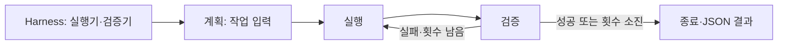

# LMS — Harness → Loop → Graph

Windows 11에서 VS Code·GitHub와 함께 사용하는 Python + LangGraph 개발 기반입니다.
현재 실행기는 **API 키가 필요 없는 결정적 예제**입니다. 실제 LLM 추론·자동 코딩·ERP 연동은
포함하지 않으며 `Harness(execute, verify)`에 실행기와 검증기를 주입해 확장합니다.



## Windows 11 설치

일반 PowerShell에서 아래를 실행합니다. 다운로드된 스크립트를 검토한 뒤 실행하세요.
Git, GitHub CLI, VS Code, Python 3.12가 없으면 winget으로 설치합니다.
설치 프로그램에 따라 Windows 권한 창이 표시될 수 있습니다.

```powershell
$installer = Join-Path $env:TEMP 'lms-install-windows.ps1'
Invoke-WebRequest 'https://raw.githubusercontent.com/myungseob77-source/LMS/main/scripts/install-windows.ps1' -OutFile $installer
notepad $installer
powershell.exe -NoProfile -ExecutionPolicy Bypass -File $installer -LoginGitHub
```

기본 경로는 `$env:USERPROFILE\source\LMS`입니다. GitHub 로그인은 브라우저에서 직접
진행합니다. 비밀번호나 토큰을 채팅·저장소에 입력하지 마세요. 이미 로그인되어 있다면
`-LoginGitHub`를 생략할 수 있습니다. GitHub Pull Requests 확장은 VS Code에서 별도로
GitHub 로그인을 요청할 수 있습니다. 설치 후 VS Code의 소스 제어에서 저장소를 확인합니다.

- `winget`이 없으면 Microsoft Store의 **앱 설치 관리자**를 설치/업데이트합니다.
- Python launcher가 있지만 3.12가 없으면 `winget install --id Python.Python.3.12 --exact` 후 재실행합니다.
- 새 도구가 인식되지 않으면 PowerShell을 닫고 다시 연 뒤 재실행합니다.
- 다른 경로: 실행 명령 뒤에 `-Destination 'D:\Projects\LMS'`를 추가합니다.
- 기존 폴더는 LMS 저장소인지 확인하며 자동 pull/reset하지 않습니다. 변경사항을 보관한 후 직접 업데이트하세요.
- 실행 정책 Bypass는 위 자식 프로세스에만 적용됩니다. PC 전체 설정은 변경하지 않습니다.

## 실행·검증

VS Code에서 F5로 그래프 예제를 디버깅하거나 **터미널 → 작업 실행**의 LMS 작업을 선택합니다.
PowerShell에서는 가상환경 활성화 없이 아래 명령을 실행할 수 있습니다.

```powershell
cd "$env:USERPROFILE\source\LMS"
.\.venv\Scripts\python.exe -m lms_engine --mode graph --task 'LMS 개발 환경 확인'
.\.venv\Scripts\python.exe -m lms_engine --mode loop --max-attempts 3
.\.venv\Scripts\python.exe -m lms_engine --diagram
.\.venv\Scripts\python.exe -m unittest discover -s tests -v
```

결과는 `.runs/*.json`에 기록되며 Git에서 제외됩니다. 작업과 결과가 그대로 기록되므로
민감정보를 작업 문자열에 넣지 마세요. `.env`는 Git에서 제외되며 자동으로 로드하지 않습니다.

## 구조

| 파일 | 역할 |
|---|---|
| `lms_engine/harness.py` | 실행기·검증기 주입 |
| `lms_engine/loop.py` | 입력 검사, 최대 1~100회 실행, 예외·실패 처리 |
| `lms_engine/graph.py` | LangGraph 단계와 재시도 분기 |
| `lms_engine/__main__.py` | CLI, Mermaid 출력, JSON 결과 |
| `scripts/install-windows.ps1` | PC 도구 설치·clone·가상환경·검증·VS Code 설정 |
| `.github/workflows/ci.yml` | Windows/Ubuntu, Python 3.11/3.12 자동 테스트 |

`plan` 노드는 현재 입력을 전달하는 자리이며 AI 계획을 생성하지 않습니다.
실행 제한은 횟수 기준입니다. 외부 서비스를 붙일 때 실행기 자체에 요청 시간 제한을 설정하세요.
그래프 상태는 실행 중 메모리에 유지됩니다. 재시작 복구·체크포인트 저장은 후속 확장입니다.

## Linux / macOS 개발

```bash
python3 -m venv .venv
.venv/bin/python -m pip install -e .
.venv/bin/python -m unittest discover -s tests -v
.venv/bin/python -m lms_engine
```

VS Code의 기본 인터프리터와 작업 명령은 Windows 기준입니다. 다른 운영체제에서는
인터프리터를 `.venv/bin/python`으로 선택하고 위 터미널 명령을 사용하세요.
